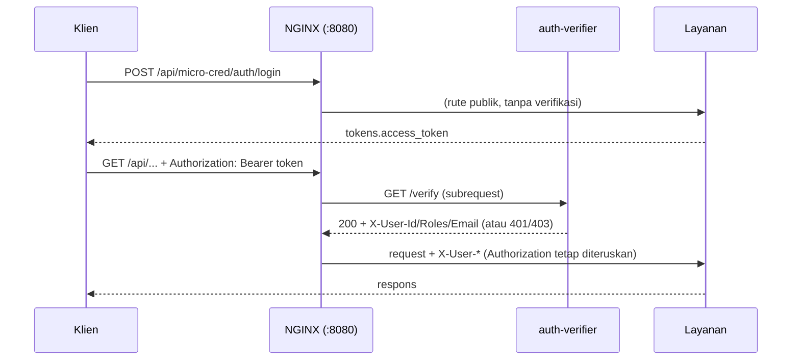

# Autentikasi Terpusat di Gateway

Micro-cred menerbitkan token JWT. NGINX (lewat `auth_request`) memverifikasinya untuk semua layanan dengan aturan **default tolak**. Micro-cred tetap memverifikasi token sendiri (dua lapis), sehingga header `Authorization` diteruskan apa adanya.

## Alur



Catatan teknis: aturan level server NGINX juga berjalan di subrequest `/_auth`, jadi `$orig_uri` dan `$orig_method` dijaga dengan `if ($uri != "/_auth")`. Subrequest `/_auth` memakai `client_max_body_size 0` agar tidak menolak upload besar yang batasnya diatur di lokasi tujuan.

Gateway menimpa header `X-User-Id`, `X-User-Roles`, `X-User-Email` dengan nilai dari token. Di rute publik nilainya kosong sehingga header buatan klien tidak diteruskan.

## Rute

| Rute | Akses |
|---|---|
| `GET /healthz` | Publik |
| `POST /api/micro-cred/auth/register` | Publik |
| `POST /api/micro-cred/auth/login` | Publik |
| `GET /api/micro-cred/health` | Publik |
| `OPTIONS` (preflight CORS) | Publik |
| Semua rute lain di `/api/micro-cred/`, `/api/judul-recommender/`, `/api/matkul-recommender/` | Wajib token |
| Path tidak dikenal | Wajib token (tanpa token 401, dengan token 404) |

## Kebijakan role

Didefinisikan di bagian atas `gateway/auth/app.py`.

| Method | Path | Role |
|---|---|---|
| POST, PUT, PATCH, DELETE | `^/api/micro-cred/(tracks\|questions)(/.*)?$` | hanya `admin` |
| lainnya | semua rute terproteksi | role sah apa pun (`student`, `advisor`, `admin`) |

Path yang dicocokkan adalah `$uri` ternormalisasi NGINX (tanpa query string, `%74racks` menjadi `tracks`, slash ganda dirapikan), bukan alamat mentah. Role di dalam Micro-cred (`require_roles`) tetap berlaku sebagai lapis kedua.

## Claim token

`sub` (id user), `roles` (daftar), `iat`, `exp`, `iss`, `email` (opsional). Verifier mewajibkan `sub`, `roles`, `exp`, mengunci algoritma ke satu nilai (`JWT_ALGORITHM`, default `HS256`), dan menolak token `none` atau algoritma lain. Nama env `JWT_SECRET`, `JWT_ALGORITHM`, `ALLOWED_ROLES` sama dengan `services/microcred/src/core/config.py`.

## Pesan error dari gateway

| Status | Isi | Kapan |
|---|---|---|
| 401 | `{"detail":"Token tidak ada atau tidak valid"}` | tanpa header, token rusak, salah tanda tangan, atau kedaluwarsa |
| 403 | `{"detail":"Akses ditolak"}` | role kosong atau tidak sah, atau role tidak cukup untuk kebijakan |
| 503 | `{"detail":"Layanan autentikasi tidak tersedia"}` | verifier mati (fail closed; rute publik tetap jalan) |

Respons 401 atau 403 dari layanan (misalnya salah password saat login) diteruskan tanpa diubah.

## Panduan singkat untuk frontend

1. Login: `POST http://127.0.0.1:8080/api/micro-cred/auth/login` dengan `{"email","password"}`. Simpan `tokens.access_token`.
2. Kirim di setiap request: `Authorization: Bearer <access_token>`.
3. Saat menerima 401: token hilang atau kedaluwarsa. Tidak ada endpoint refresh, jadi arahkan pengguna login ulang.
4. Profil pengguna (nama, NIM, fakultas, prodi): `GET /api/micro-cred/auth/me`. Jangan membaca data itu dari token.
5. CORS: hanya origin di `map $http_origin $cors_origin` pada `gateway/nginx/nginx.conf` yang diizinkan (saat ini `127.0.0.1` dan `localhost` port 5500 dan 5173). Untuk menambah origin frontend, tambahkan baris `"http://host:port"  $http_origin;`, lalu `docker compose restart nginx`. Tanpa wildcard dan tanpa cookie/credentials.

## Menjalankan uji

```powershell
powershell -File gateway\auth\smoke-test.ps1
```

## Keterbatasan

- Token stateless: tetap berlaku sampai kedaluwarsa walau akun diubah, dinonaktifkan, atau rolenya berubah. `src/api/deps.py` juga tidak memeriksa database.
- Secret simetris (HS256) dibagi ke verifier. Verifier menerima seluruh `.env` Micro-cred lewat `env_file` (termasuk kredensial lain seperti database dan API key). Saran: pakai kunci asimetris (verifier hanya memegang kunci publik) atau Docker secrets yang hanya berisi `JWT_SECRET`.
- Verifier menolak start bila `JWT_SECRET` kosong atau masih nilai bawaan Micro-cred (`replace-with-secure-secret`). Micro-cred sendiri tetap memakai nilai bawaan itu bila `.env` tidak mengisinya, jadi pastikan `.env` berisi secret sungguhan.
- Tidak ada endpoint refresh: pengguna login ulang saat token kedaluwarsa.
- Tidak ada rate limiting, termasuk pada login dan registrasi.
- Halaman frontend (UI) belum dilindungi gateway, hanya API.
- `refresh_token` dari Micro-cred adalah JWT biasa dengan claim yang sama dan TTL 7 hari, tanpa claim jenis token. Akibatnya token itu bisa dipakai sebagai access token di gateway selama 7 hari, dan tidak ada endpoint refresh. Frontend dianjurkan TIDAK menyimpan `refresh_token`. Saran perbaikan: tambah claim jenis token di `core/auth.py` (belum dikerjakan).
- Registrasi mandiri sebagai `advisor` diizinkan (`admin` ditolak 403). Dampaknya terbatas pada endpoint feedback.
- Kepemilikan assessment per pengguna belum diaudit.
- Verifier bergantung pada `env_file` Micro-cred agar `JWT_SECRET` dan `JWT_ALGORITHM` sinkron.
- Registrasi menerima `role` dari klien: `student` dan `advisor` diterima, `admin` ditolak 403 oleh Micro-cred. Siapa pun bisa menjadi `advisor`. Kebijakan gateway memakai role `admin` untuk menulis tracks dan questions, sehingga celah `admin` tertutup, tetapi role `advisor` bisa diperoleh sendiri oleh pengguna.


