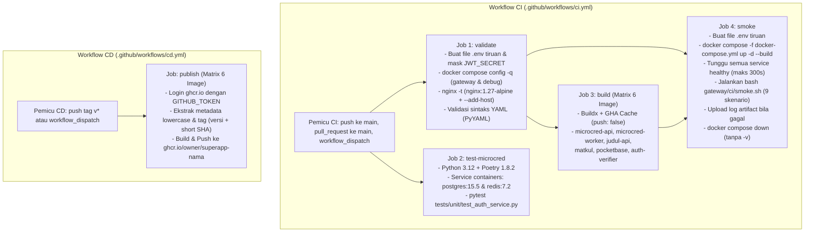

# Bab 3 — Perancangan dan Implementasi Pipeline CI/CD (`superapp-gateway`)

Dokumen ini menjelaskan arsitektur, tahapan eksekusi, manajemen konfigurasi/rahasia (*secrets*), strategi *caching*, cara verifikasi lokal, serta keterbatasan dari pipeline **Continuous Integration (CI)** dan **Continuous Delivery (CD)** pada repositori `superapp-gateway` menggunakan **GitHub Actions**.

---

## 1. Diagram Alur Pipeline (CI & CD)



---

## 2. Tabel Tahapan Pipeline, Pemicu, Tujuan, dan Hasil Keluaran

| Workflow | Nama Job | Pemicu (*Trigger*) | Prasyarat (`needs`) | Tujuan Tahapan | Hasil Keluaran (*Output / Artifact*) |
| :--- | :--- | :--- | :--- | :--- | :--- |
| **CI** ([`ci.yml`](../.github/workflows/ci.yml)) | **`validate`** | `push` (`main`), `pull_request` (`main`), `workflow_dispatch` | — | Memvalidasi kelengkapan konfigurasi `docker-compose.yml` (mode gateway dan mode override debug), menguji sintaks `gateway/nginx/nginx.conf` menggunakan `nginx:1.27-alpine` (`nginx -t`), serta memverifikasi sintaks seluruh berkas YAML. | Status kelulusan validasi statis konfigurasi Compose, NGINX, dan YAML. |
| **CI** ([`ci.yml`](../.github/workflows/ci.yml)) | **`test-microcred`** | `push` (`main`), `pull_request` (`main`), `workflow_dispatch` | — | Menjalankan pengujian unit layanan identitas dan autentikasi Micro-cred (`Python 3.12`, `Poetry 1.8.2`) dengan dukungan *service containers* `postgres:15.5` dan `redis:7.2`. | Laporan eksekusi `pytest` untuk logika registrasi mahasiswa (NIM, fakultas, prodi), login, dan penanganan *constraint* unik. |
| **CI** ([`ci.yml`](../.github/workflows/ci.yml)) | **`build`** | `push` (`main`), `pull_request` (`main`), `workflow_dispatch` | `validate` | Membangun (*build*) ke-6 image aplikasi (`microcred-api`, `microcred-worker`, `judul-api`, `matkul`, `pocketbase`, `auth-verifier`) secara paralel menggunakan Docker Buildx tanpa mempublikasikan ke *registry*. | Lapisan (*layers*) cache Docker yang tersimpan di GitHub Actions Cache (`type=gha`) per layanan. |
| **CI** ([`ci.yml`](../.github/workflows/ci.yml)) | **`smoke`** | `push` (`main`), `pull_request` (`main`), `workflow_dispatch` | `validate`, `build` | Menjalankan seluruh stack pada mode gateway (`docker compose -f docker-compose.yml up -d --build`), menunggu semua container `healthy` (maks. 300 detik), dan mengeksekusi [`gateway/ci/smoke.sh`](../gateway/ci/smoke.sh). | Status kelulusan 9 kelompok uji integrasi gateway (`PASS`/`FAIL`), serta artefak `compose-smoke-logs-<run_id>` apabila terjadi kegagalan. |
| **CD** ([`cd.yml`](../.github/workflows/cd.yml)) | **`publish`** | `push` tag `v*` (mis. `v1.0.0`), `workflow_dispatch` | — | Membangun dan mempublikasikan ke-6 image layanan ke **GitHub Container Registry (GHCR)** dengan penamaan huruf kecil `ghcr.io/<owner>/superapp-<nama>`. | 6 paket image container di GHCR berlabel tag versi rilis (mis. `v1.0.0`) dan *short Git SHA*. |

> **Pengaturan Konkurensi & Hak Akses Minimal**:
> - `ci.yml` menerapkan `concurrency` berbasis `${{ github.workflow }}-${{ github.ref }}` dengan `cancel-in-progress: true` agar *commit* baru pada *branch* atau *Pull Request* yang sama otomatis membatalkan eksekusi lama yang masih berjalan.
> - Hak akses bawaan `GITHUB_TOKEN` dibatasi ke `contents: read` di tingkat *workflow*. Hak akses `packages: write` hanya diberikan secara khusus pada job `publish` di [`cd.yml`](../.github/workflows/cd.yml).

---

## 3. Manajemen Secret dan Alasan Penggunaan Nilai Tiruan (*Mock Values*)

### 3.1. Daftar Secret yang Dipakai
- **`GITHUB_TOKEN` (Otomatis dari GitHub Actions)**: Satu-satunya kredensial asli yang digunakan oleh workflow, dipakai pada job `publish` di [`cd.yml`](../.github/workflows/cd.yml) untuk autentikasi ke `ghcr.io` melalui `docker/login-action@v3`. Tidak ada *repository secret* eksternal (seperti kunci OpenAI, Groq, atau Resend asli) yang disimpan maupun dimuat di CI.

### 3.2. Penyusunan Berkas `.env` Tiruan di CI dan Alasannya
Pada job `validate` dan `smoke`, berkas lingkungan dibuat secara dinamis sebelum perintah `docker compose` dijalankan:
1. **`services/microcred/.env`** (disalin dari [`services/microcred/.env.example`](../services/microcred/.env.example)):
   - `JWT_SECRET` diganti dengan nilai acak 32-byte heksadesimal (`openssl rand -hex 32`) dan langsung disembunyikan dari log menggunakan `::add-mask::`. Langkah ini wajib karena baik `microcred-api` maupun `auth-verifier` membaca `services/microcred/.env`, dan `auth-verifier` secara eksplisit menolak *startup* (*fail-fast*) apabila `JWT_SECRET` masih bernilai bawaan `replace-with-secure-secret`.
   - Variabel database dipertahankan konsisten dengan `.env.example` (`POSTGRES_DB=microcred`, `POSTGRES_USER=microcred`, `POSTGRES_PASSWORD=postgres-password`, `DATABASE_URL=postgresql+asyncpg://microcred:postgres-password@db:5432/microcred`).
   - `OPENAI_API_KEY=placeholder-openai-key` dan `RESEND_API_KEY=placeholder-resend-key` tetap berupa nilai tiruan.
2. **`services/judul/.env`**:
   - Diisi `GROQ_API_KEY=gsk_ci_dummy_key_not_for_production` agar container `judul-api` dapat melewati inisialisasi konfigurasi saat *startup* tanpa memerlukan kunci Groq asli.
3. **`services/matkul/.env.local`**:
   - Diisi `OPENAI_API_KEY=sk-ci-dummy-key-not-for-production`, `PB_ADMIN_EMAIL=admin@example.com`, dan `PB_ADMIN_PASSWORD=ci-dummy-password-12345` agar container Next.js (`matkul`) dapat berjalan tanpa kredensial produksi.

**Alasan Penggunaan Nilai Tiruan**:
- Mencegah kebocoran kredensial berbayar pada log CI atau *Pull Request*.
- Menghindari biaya pemanggilan API LLM (OpenAI & Groq) serta pengiriman email nyata (Resend) pada setiap *commit*.
- Menjaga agar pengujian CI bersifat deterministik (tidak gagal akibat kuota kredit API pihak ketiga habis atau gangguan jaringan eksternal).

---

## 4. Cakupan Pengujian Unit Micro-cred & Tes yang Dilewati

Pada job `test-microcred`, konfigurasi meniru [`services/microcred/.github/workflows/ci.yml`](../services/microcred/.github/workflows/ci.yml) (`Python 3.12`, `poetry==1.8.2`, `poetry config virtualenvs.create false`, `poetry install --no-root`) dengan *working directory* `services/microcred` serta *service containers* `postgres:15.5` dan `redis:7.2`.

- **Tes yang Dijalankan**:
  - `poetry run pytest tests/unit/test_auth_service.py -v` (14 kasus uji unit mencakup registrasi mahasiswa dengan NIM/fakultas/prodi, normalisasi `trim`, penolakan NIM non-digit, pembedaan duplikasi constraint `ix_users_nim` vs email termasuk kasus alamat email yang memuat substring `"nim"` seperti `nimas@example.com`, serta alur login).
- **Tes dan Langkah Bawaan yang Dilewati Beserta Alasannya**:
  1. **Tes endpoint registrasi lama di luar `test_auth_service.py` (mis. `tests/api/` atau tes integrasi rute lama)**: Dilewati karena sejak perluasan skema registrasi SuperApp ([`src/api/schemas/auth.py`](../services/microcred/src/api/schemas/auth.py)), endpoint `POST /auth/register` mewajibkan field `nim`, `faculty`, dan `study_program`. Tes bawaan lama yang mengirim payload registrasi tanpa ketiga field tersebut akan ditolak oleh validasi Pydantic (`422`), sementara aturan repositori melarang pengubahan berkas tes lama di luar `test_auth_service.py`.
  2. **Job `integration-tests` bawaan Micro-cred**: Pada [`services/microcred/.github/workflows/ci.yml`](../services/microcred/.github/workflows/ci.yml) baris 46–66, job tersebut hanya berisi perintah *placeholder* (`echo "Integration test suite placeholder..."`). Sebagai gantinya, pengujian integrasi nyata lintas-layanan dilakukan secara menyeluruh pada job `smoke` menggunakan [`gateway/ci/smoke.sh`](../gateway/ci/smoke.sh).
  3. **Langkah `ruff check` / `ruff format --check` dan `scripts/export_openapi.py`**: Dilewati pada `test-microcred` agar fokus pada verifikasi fungsional unit autentikasi tanpa terblokir oleh perbedaan pemformatan berkas warisan (*legacy files*) di repositori Micro-cred yang tidak boleh diubah.

---

## 5. Strategi Cache dan Versi Action yang Digunakan

### 5.1. Strategi Cache Buildx
- Job `build` (di `ci.yml`) dan `publish` (di `cd.yml`) menggunakan **GitHub Actions Cache backend (`type=gha`)** melalui `docker/build-push-action@v5`:
  - `cache-from: type=gha,scope=<nama-service>`
  - `cache-to: type=gha,mode=max,scope=<nama-service>`
- Pemisahan `scope` per layanan (`microcred-api`, `microcred-worker`, `judul-api`, `matkul`, `pocketbase`, `auth-verifier`) mencegah saling timpa cache antar-image di dalam *matrix strategy*.

### 5.2. Daftar Versi Mayor GitHub Actions
Seluruh *action* menggunakan versi mayor stabil yang terverifikasi:
- `actions/checkout@v4`
- `actions/setup-python@v5`
- `actions/upload-artifact@v4`
- `docker/setup-buildx-action@v3`
- `docker/login-action@v3`
- `docker/metadata-action@v5`
- `docker/build-push-action@v5` *(dipilih `@v5` sebagai versi mayor konservatif yang stabil dan kompatibel penuh dengan `docker/setup-buildx-action@v3` serta `docker/metadata-action@v5`)*.

---

## 6. Cara Menjalankan Smoke Test di Laptop (Mode Gateway)

Skrip [`gateway/ci/smoke.sh`](../gateway/ci/smoke.sh) ditulis dalam Bash (baris akhir `LF`) menggunakan `curl` dan `jq` (dengan *fallback* otomatis ke `python` apabila biner `jq` belum terpasang di Git Bash Windows). Untuk menjalankannya secara lokal terhadap stack mode gateway:

```bash
# 1. Jalankan stack dalam mode gateway saja (hanya port 127.0.0.1:8080 yang dibuka)
docker compose -f docker-compose.yml up -d

# 2. Jalankan smoke test CI lewat Git Bash
bash gateway/ci/smoke.sh

# 3. Kembalikan stack ke mode pengembangan biasa (memuat docker-compose.override.yml)
docker compose up -d
```

Sembilan skenario yang diuji oleh [`gateway/ci/smoke.sh`](../gateway/ci/smoke.sh):
1. `GET /healthz` (`200`) dan `GET /api/micro-cred/health` (`200`) dengan *polling* kesiapan hingga 120 detik.
2. Registrasi mahasiswa acak (`email`, `password` $\ge 8$ karakter, `full_name`, `nim` 8 digit acak, `faculty`, `study_program`) $\rightarrow$ `201`, dilanjutkan `POST /api/micro-cred/auth/login` $\rightarrow$ `200` dan ekstraksi `tokens.access_token` (disimpan di variabel memori, tidak pernah dicetak).
3. Akses tanpa token $\rightarrow$ `401` pada `GET /api/micro-cred/tracks`, `GET /api/judul-recommender/`, dan `POST /api/matkul-recommender/rekomendasi`.
4. Akses dengan token `student` $\rightarrow$ `GET /api/micro-cred/tracks` (`200`), `GET /api/judul-recommender/` (`200`), dan `POST` file kecil non-PDF ke `/api/matkul-recommender/panduan/extract-upload` (`400` dari aplikasi).
5. Pembatasan RBAC `student` $\rightarrow$ `POST /api/micro-cred/tracks` dengan body `{}` ditolak gateway dengan `403` (`{"detail":"Akses ditolak"}`).
6. Batas unggahan NGINX $\rightarrow$ unggah file 17 MB ke `/api/matkul-recommender/panduan/extract-upload` ditolak NGINX dengan `413` JSON (`{"detail":"Ukuran file melebihi batas"}`).
7. Kebijakan preflight CORS $\rightarrow$ `OPTIONS` dengan `Origin: http://127.0.0.1:5500` menghasilkan `204` beserta `Access-Control-Allow-Origin: http://127.0.0.1:5500`; sedangkan `Origin: http://evil.example` menghasilkan `204` tanpa header tersebut.
8. Penolakan token asing $\rightarrow$ token yang ditandatangani dengan *secret* acak berbeda di dalam container `auth-verifier` ditolak dengan `401`.
9. Pencegahan *policy bypass* $\rightarrow$ `POST /api/micro-cred/%74racks` (`curl --path-as-is`) dengan token `student` tetap dinormalisasi dan ditolak dengan `403`.

---

## 7. Keterbatasan Pipeline CI/CD

1. **Tanpa Pengujian Endpoint LLM di CI**: Pipeline CI sengaja tidak memanggil endpoint yang bergantung pada API OpenAI maupun Groq (seperti `POST /api/judul-recommender/get-recommendations` atau pipeline skoring esai Micro-cred) untuk menghindari ketergantungan pada kuota berbayar dan menjaga keandalan pengujian otomatis.
2. **Tanpa Target Deploy Otomatis ke Server**: Workflow [`cd.yml`](../.github/workflows/cd.yml) hanya mencakup tahap *Continuous Delivery* berupa pembuatan dan publikasi *image* ke GitHub Container Registry (`ghcr.io/<owner>/superapp-<nama>`), belum mencakup *deployment* otomatis (SSH/Kubernetes/ Watchtower) ke server produksi.
3. **Waktu Build Image `matkul` Paling Lama**: Di antara ke-6 image, proses *build* container `matkul` (instalasi dependensi `npm` dan kompilasi `next build` pada Next.js) membutuhkan waktu paling lama, terutama pada eksekusi pertama sebelum cache `type=gha` terbentuk.
4. **Duplikasi Skrip Smoke Test Lintas-Platform**: Skrip [`gateway/auth/smoke-test.ps1`](../gateway/auth/smoke-test.ps1) tetap dipertahankan khusus untuk pengujian interaktif berbasis PowerShell di Windows (38 kasus uji detail), sedangkan [`gateway/ci/smoke.sh`](../gateway/ci/smoke.sh) (Bash) digunakan untuk lingkungan runner Linux di GitHub Actions dan Git Bash.

---

## 8. Hasil Verifikasi Lokal

1. **Validasi Sintaks YAML (`PyYAML`)**:
   - Seluruh berkas YAML ([`.github/workflows/ci.yml`](../.github/workflows/ci.yml), [`.github/workflows/cd.yml`](../.github/workflows/cd.yml), [`services/microcred/.github/workflows/ci.yml`](../services/microcred/.github/workflows/ci.yml), [`docker-compose.yml`](../docker-compose.yml), dan [`docker-compose.override.yml`](../docker-compose.override.yml)) lolos `yaml.safe_load()` tanpa galat.
2. **Validasi Konfigurasi NGINX (`nginx -t` dengan `--add-host`)**:
   ```text
   nginx: the configuration file /etc/nginx/nginx.conf syntax is ok
   nginx: configuration file /etc/nginx/nginx.conf test is successful
   ```
3. **Eksekusi `bash gateway/ci/smoke.sh` terhadap Stack Mode Gateway (`docker compose -f docker-compose.yml up -d`)**:
   ```text
   == 1. Health check publik (/healthz dan /api/micro-cred/health, tunggu maks 120s) ==
   PASS  GET /healthz -> 200  (200)
   PASS  GET /api/micro-cred/health -> 200  (200)
   == 2. Registrasi akun acak (201) dan login (200) ==
   PASS  POST /api/micro-cred/auth/register -> 201  (201)
   PASS  POST /api/micro-cred/auth/login -> 200 + access_token  (200)
   == 3. Akses rute terproteksi tanpa token -> 401 ==
   PASS  GET /api/micro-cred/tracks tanpa token -> 401  (401)
   PASS  GET /api/judul-recommender/ tanpa token -> 401  (401)
   PASS  POST /api/matkul-recommender/rekomendasi tanpa token -> 401  (401)
   == 4. Akses rute dengan token student sah ==
   PASS  GET /api/micro-cred/tracks (student) -> 200  (200)
   PASS  GET /api/judul-recommender/ (student) -> 200  (200)
   PASS  POST /api/matkul-recommender/panduan/extract-upload non-PDF -> 400  (400)
   == 5. Token student menulis ke /api/micro-cred/tracks -> 403 ==
   PASS  POST /api/micro-cred/tracks (student) -> 403 JSON  (403 Akses ditolak)
   == 6. Upload 17 MB -> 413 JSON dari NGINX ==
   PASS  Upload 17 MB -> 413 JSON  (413 Ukuran file melebihi batas)
   == 7. Preflight CORS ==
   PASS  OPTIONS preflight origin diizinkan -> 204 + ACAO  (204)
   PASS  OPTIONS preflight origin asing -> 204 tanpa ACAO  (204)
   == 8. Token ditandatangani dengan secret lain -> 401 ==
   PASS  Token dengan secret asing -> 401  (401)
   == 9. Percobaan melewati kebijakan (/api/micro-cred/%74racks) -> 403 ==
   PASS  POST /api/micro-cred/%74racks (--path-as-is) -> 403  (403)
   == Ringkasan: 0 FAIL ==
   ```


