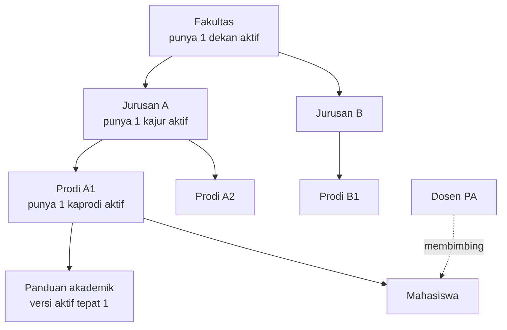

# 02. Struktur Organisasi

## Hierarki

## Aturan jumlah

| Hubungan | Aturan |
|---|---|
| Fakultas → Jurusan | satu fakultas, banyak jurusan |
| Jurusan → Prodi | satu jurusan, banyak prodi |
| Prodi → Panduan akademik | satu prodi, banyak versi, **tepat satu aktif** |
| Prodi → Mahasiswa | satu prodi, banyak mahasiswa; satu mahasiswa satu prodi aktif |
| Dosen PA → Mahasiswa | satu dosen, banyak mahasiswa; satu mahasiswa **satu PA aktif** |
| Fakultas → Dekan | maksimal satu penugasan aktif |
| Jurusan → Kajur | maksimal satu penugasan aktif |
| Prodi → Kaprodi | maksimal satu penugasan aktif |
| Unit → Dosen PA | banyak, ditugaskan pada prodi atau jurusan |

Catatan dari diskusi awal: ide semula "prodi punya satu kaprodi dan n kepala jurusan" diganti. Kepala jurusan melekat pada **jurusan** (satu per jurusan), karena jurusan berada di atas prodi.

## Contoh data

| Fakultas | Jurusan | Prodi |
|---|---|---|
| Fakultas Teknologi Industri | Informatika | Informatika (S1) |
| Fakultas Teknologi Industri | Informatika | Informatika Program Internasional |
| Fakultas Teknologi Industri | Teknik Industri | Teknik Industri (S1) |

Nama di atas hanya contoh bentuk data, bukan data resmi kampus.

## Identitas unit

Setiap unit punya:
- `id` (UUID), tidak berubah.
- `kode` pendek unik di tingkatnya (misal `FTI`, `IF`, `IF-S1`), dipakai di laporan.
- `nama` yang boleh diubah.
- `aktif` untuk menutup unit tanpa menghapus riwayat.

Unit **tidak dihapus** jika masih punya anak, penugasan, atau mahasiswa. Cukup dinonaktifkan.

## Riwayat jabatan

Jabatan (dekan, kajur, kaprodi, dosen PA) disimpan sebagai penugasan bertanggal, bukan kolom di unit. Akibatnya:
- Pergantian kaprodi menutup penugasan lama (`selesai` diisi) dan membuka yang baru.
- Dokumen lama tetap bisa menunjukkan siapa kaprodi pada tanggal tertentu.
- Satu orang bisa menjabat di dua unit sekaligus tanpa akun ganda.
