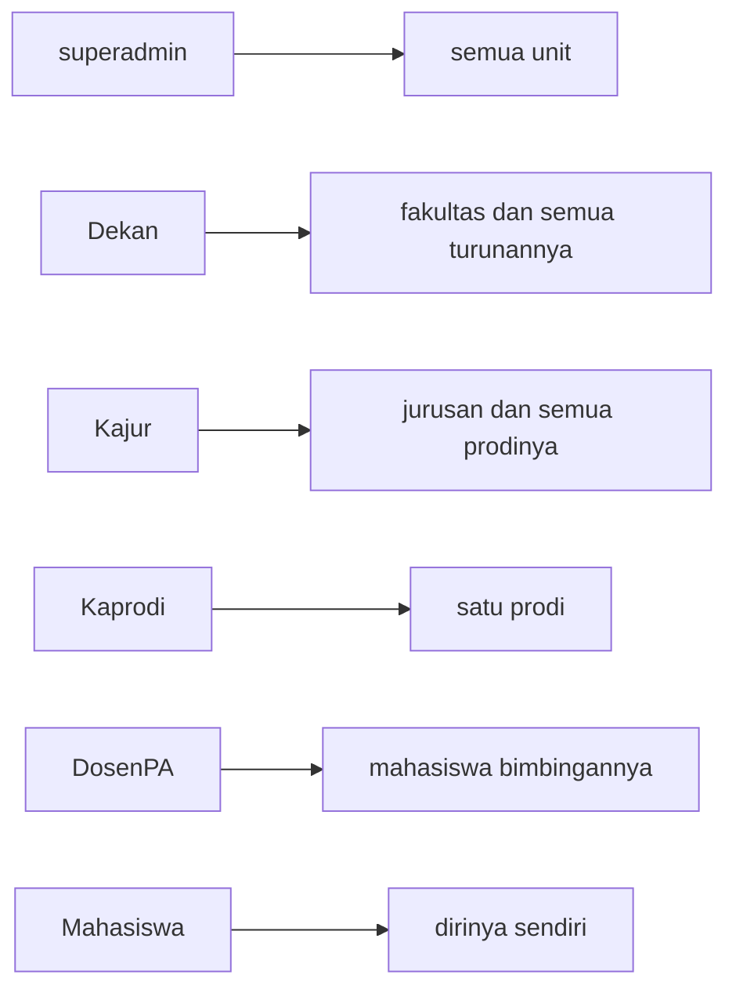

# 03. Peran dan Hak Akses

## Peran

| Peran | Ruang lingkup | Keterangan |
|---|---|---|
| `superadmin` | global | Mengelola seluruh struktur, akun, dan penugasan |
| `dekan` | satu fakultas | Melihat seluruh jurusan dan prodi di fakultasnya |
| `kajur` | satu jurusan | Melihat seluruh prodi di jurusannya |
| `kaprodi` | satu prodi | Mengelola panduan akademik dan penugasan PA di prodinya |
| `dosen_pa` | prodi atau jurusan | Melihat mahasiswa bimbingannya |
| `mahasiswa` | dirinya sendiri | Melihat data sendiri |

Satu orang boleh punya banyak penugasan. Hak akses adalah gabungan seluruh penugasan yang sedang aktif.

## Pewarisan ruang lingkup

Pemegang jabatan di atas boleh membaca unit di bawahnya. Tidak sebaliknya.

## Matriks hak (R = baca, W = tulis, - = tidak)

| Sumber daya | superadmin | dekan | kajur | kaprodi | dosen_pa | mahasiswa |
|---|---|---|---|---|---|---|
| Fakultas | RW | R (miliknya) | R | R | R | R |
| Jurusan | RW | R (fakultasnya) | R (miliknya) | R | R | R |
| Prodi | RW | R | R | R (miliknya) | R | R |
| Akun dan orang | RW | R (cakupannya) | R (cakupannya) | R (cakupannya) | R (bimbingannya) | R (dirinya) |
| Penugasan jabatan | RW | - | - | - | - | - |
| Penugasan dosen PA | RW | - | - | RW (prodinya) | R | R (miliknya) |
| Mahasiswa di prodi | RW | R | R | RW | R (bimbingannya) | R (dirinya) |
| Panduan akademik | RW | R | R | RW (prodinya) | R | R |
| Audit log | R | - | - | - | - | - |

Catatan:
- Hanya superadmin yang membuat atau menutup penugasan dekan, kajur, kaprodi. Alasannya: jabatan struktural adalah keputusan institusi.
- Kaprodi mengatur dosen PA di prodinya karena paling tahu beban bimbingan.
- Aturan ini adalah usulan awal dan perlu dikonfirmasi ([10](10-pertanyaan-terbuka.md)).

## Di mana aturan ditegakkan

| Lapis | Tugas |
|---|---|
| NGINX + verifier | Memastikan token sah dan peran dikenal. Rute tulis struktur hanya `superadmin` |
| Layanan identity | Menyaring data berdasarkan cakupan unit dari klaim token |
| Database | Batasan unik dan kunci asing, sehingga data salah tidak bisa tersimpan |

Frontend boleh menyembunyikan tombol, tetapi **bukan** penegak aturan.

## Akun superadmin pertama

Dibuat lewat perintah pada saat instalasi (lihat [09](09-rencana-implementasi.md)), bukan lewat endpoint publik. Sandi awal wajib diganti pada login pertama.
