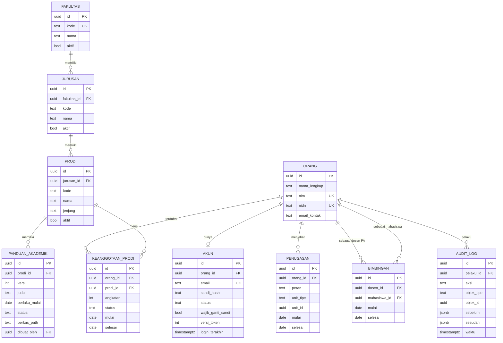

# 04. Model Data

Database: Postgres 15, nama `identity`, layanan `identity-db` (terpisah dari `db` milik Micro-cred). Migrasi dengan Alembic. Semua primary key UUID.

## ERD

## Tabel inti

### `fakultas`, `jurusan`, `prodi`
- `kode` unik per induk (`(fakultas_id, kode)` pada jurusan, `(jurusan_id, kode)` pada prodi). Kode fakultas unik global.
- `prodi.jenjang`: `D3`, `S1`, `S2`, `S3`, `Profesi`.
- `aktif=false` menutup unit. Unit tidak dihapus fisik.

### `orang` dan `akun`
- `orang` menyimpan identitas. `akun` menyimpan kredensial. Satu orang paling banyak satu akun.
- `nim` unik, hanya terisi untuk mahasiswa. `nidn` unik, hanya untuk dosen.
- `akun.email` disimpan huruf kecil. Pelajaran dari proyek StudentGateway: email berbeda huruf besar-kecil pernah menyebabkan undangan tidak cocok.
- `akun.status`: `aktif`, `ditangguhkan`, `nonaktif`.
- `akun.versi_token`: dinaikkan untuk membatalkan semua token lama akun itu (lihat [05](05-alur-auth-dan-token.md)).

### `penugasan`
Satu tabel untuk semua jabatan. `peran` salah satu: `superadmin`, `dekan`, `kajur`, `kaprodi`, `dosen_pa`.
- `unit_tipe`: `global`, `fakultas`, `jurusan`, `prodi`. `unit_id` kosong jika `global`.
- Pasangan peran dan tipe unit divalidasi:

| peran | unit_tipe yang sah |
|---|---|
| superadmin | global |
| dekan | fakultas |
| kajur | jurusan |
| kaprodi | prodi |
| dosen_pa | prodi, jurusan |

- Aktif berarti `mulai <= hari ini` dan (`selesai IS NULL` atau `selesai > hari ini`). Tanggal `selesai` bersifat **eksklusif**: mengakhiri penugasan pada hari X membuatnya tidak aktif mulai X, sehingga pengganti boleh mulai di hari yang sama.
- Peran `mahasiswa` tidak disimpan di sini. Ia diturunkan dari `keanggotaan_prodi` yang aktif.

### `keanggotaan_prodi`
Mahasiswa terdaftar di prodi. `status`: `aktif`, `cuti`, `lulus`, `keluar`, `pindah`. Pindah prodi menutup baris lama dan membuka baris baru.

### `bimbingan`
Hubungan dosen PA dengan mahasiswa, bertanggal. Pergantian PA menutup baris lama.

### `panduan_akademik`
- `versi` bertambah per prodi, mulai dari 1.
- `status`: `draf`, `aktif`, `diarsipkan`.
- Satu prodi hanya boleh punya satu baris `aktif`.
- Berkas disimpan sebagai path, isinya di penyimpanan berkas layanan.
- Memperbarui panduan berarti membuat versi baru lalu mengaktifkannya. Versi lama menjadi `diarsipkan` dan tetap bisa dibuka.

### `audit_log`
Hanya tambah, tidak diubah atau dihapus. Mencatat semua perubahan struktur, penugasan, dan akun.

## Batasan di database (ditegakkan, bukan hanya di kode)

| Aturan | Cara |
|---|---|
| Satu dekan aktif per fakultas | indeks unik parsial pada `penugasan(unit_id)` WHERE peran='dekan' AND selesai IS NULL |
| Satu kajur aktif per jurusan | idem, peran='kajur' |
| Satu kaprodi aktif per prodi | idem, peran='kaprodi' |
| Satu PA aktif per mahasiswa | indeks unik parsial pada `bimbingan(mahasiswa_id)` WHERE selesai IS NULL |
| Satu keanggotaan prodi aktif per mahasiswa | indeks unik parsial pada `keanggotaan_prodi(orang_id)` WHERE selesai IS NULL |
| Satu panduan aktif per prodi | indeks unik parsial pada `panduan_akademik(prodi_id)` WHERE status='aktif' |
| `selesai >= mulai` | CHECK |
| Dosen PA tidak membimbing dirinya | CHECK `dosen_id <> mahasiswa_id` |
| Email unik tanpa beda huruf | indeks unik pada `lower(email)` |

Catatan: indeks unik parsial dengan `selesai IS NULL` tidak mencegah dua penugasan yang tumpang tindih tetapi sudah bertanggal selesai. Untuk itu ada validasi di kode, dan opsional batasan eksklusi `daterange` jika diperlukan.
