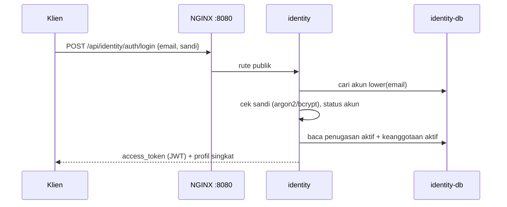

# 05. Alur Auth dan Token

## Login

Galat login sengaja seragam ("email atau sandi salah") agar tidak membocorkan keberadaan akun. Percobaan gagal dibatasi laju.

## Klaim JWT

| Klaim | Isi |
|---|---|
| `sub` | id akun |
| `orang` | id orang |
| `roles` | daftar peran aktif, misal `["dosen_pa","kaprodi"]` |
| `scopes` | daftar unit, misal `[{"peran":"kaprodi","tipe":"prodi","id":"..."}]` |
| `tv` | versi token akun saat diterbitkan |
| `iat`, `exp`, `iss` | standar |

`roles` memakai nama yang sama dengan `ALLOWED_ROLES` di verifier. Peran baru perlu ditambahkan di sana (lihat [07](07-integrasi-dan-deprecation.md)).

Ukuran token dijaga kecil: jika `scopes` sangat banyak (superadmin), cukup `{"tipe":"global"}`.

## Masa berlaku dan penyegaran

| Token | Masa berlaku | Catatan |
|---|---|---|
| access_token | 15 menit | dikirim di header `Authorization` |
| refresh_token | 7 hari | disimpan hash-nya di database, sekali pakai (rotasi) |

Ini berbeda dari Micro-cred yang tidak punya refresh. Alasannya: dengan hierarki dan perubahan jabatan, token berumur panjang membuat perubahan peran lambat berlaku.

## Pencabutan

Token tetap stateless di gateway (verifier hanya memeriksa tanda tangan). Untuk membatasi dampaknya:

1. Access token pendek (15 menit), jadi perubahan peran berlaku paling lama 15 menit.
2. Refresh token disimpan di database. Menangguhkan akun atau mengubah sandi menghapus refresh token, sehingga token baru tidak bisa diterbitkan.
3. `akun.versi_token` dinaikkan saat penangguhan. Layanan identity sendiri menolak token dengan `tv` lama pada endpoint yang sensitif (ubah sandi, kelola penugasan).

**Pembaruan:** verifier gateway kini juga memeriksa `tv`. Untuk token yang membawa `tv` (token identity), verifier menanyakan `GET /internal/akun/{sub}/versi-token` ke identity (header `X-Internal-Token`, hasil di-cache `TV_CACHE_TTL`, bawaan 5 detik) dan menolak bila versi tidak cocok atau akun tidak aktif. Akibatnya penangguhan akun dan ganti sandi berlaku untuk **semua** layanan dalam hitungan detik, bukan 15 menit. Bila identity tidak terjangkau, verifier menjawab 503 (fail closed). Token lama Micro-cred tanpa `tv` dilewati. Endpoint internal tidak terjangkau dari luar: NGINX menjawab 404 untuk `/api/identity/internal/*`, dan tanpa `INTERNAL_TOKEN` yang benar endpoint menjawab 404.

## Sandi

- Hash dengan argon2id (atau bcrypt jika argon2 sulit dipasang).
- Kebijakan: minimal 10 karakter, tidak boleh sama dengan email.
- `wajib_ganti_sandi=true` untuk akun yang dibuat admin. Selama true, token hanya boleh mengakses endpoint ganti sandi.
- Lupa sandi: tahap lanjutan (butuh pengiriman email). Sementara, superadmin mengatur ulang sandi.

## Pembuatan akun

| Siapa | Cara |
|---|---|
| Superadmin pertama | perintah CLI saat instalasi |
| Dosen dan mahasiswa | dibuat superadmin (satu per satu atau impor CSV) |
| Mandiri (register publik) | **tidak ada**, karena akun kampus harus dikaitkan ke NIM/NIDN yang sah |

## Penyimpanan rahasia

`JWT_SECRET` diisi lewat `.env`, tanpa nilai bawaan, dan layanan menolak start jika kosong (mengikuti pola verifier yang sudah ada).
