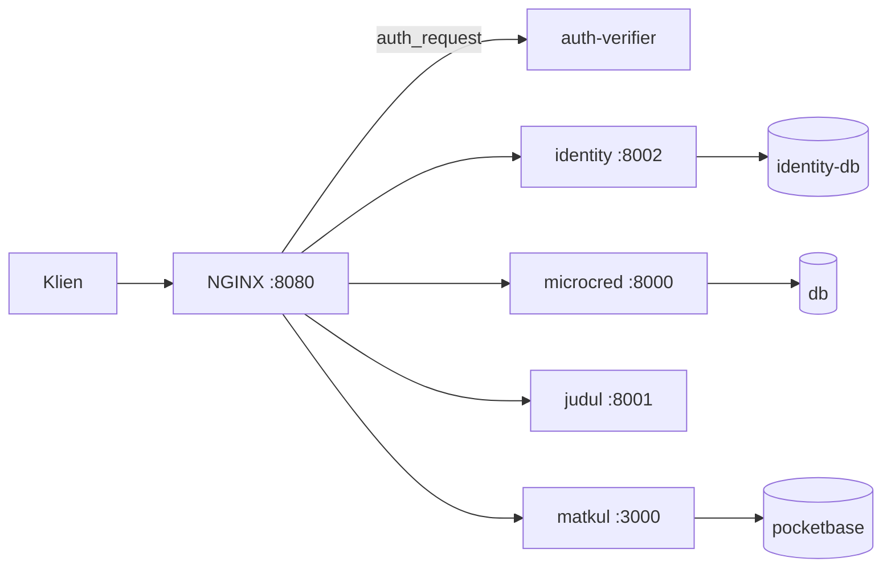

# 07. Integrasi dan Penonaktifan yang Lama

## Posisi layanan baru

Port 8002 untuk identity masih usulan. Cek bentrok dengan [port-map](../port-map.md) sebelum dipakai.

## Perubahan di gateway

| Berkas | Perubahan |
|---|---|
| `docker-compose.yml` | tambah `identity-api` dan `identity-db` (volume `identity_pg`), healthcheck |
| `docker-compose.override.yml` | port debug `127.0.0.1:8002` |
| `gateway/nginx/nginx.conf` | rute `/api/identity/*`; publik: `auth/login`, `auth/refresh`, `health` |
| `gateway/auth/app.py` | tambah peran baru ke `DEFAULT_ROLES`; aturan hanya-superadmin untuk tulis struktur |
| `docs/port-map.md`, `nginx-routing.md`, `auth-gateway.md` | diperbarui |
| `.github/workflows` | tambah job uji identity |

### Satu rahasia JWT

Identity dan verifier memakai `JWT_SECRET` dan `JWT_ALGORITHM` yang sama. Saat ini verifier membaca `.env` Micro-cred. Usul: pindahkan ke satu berkas `.env` di akar atau di `gateway/`, supaya tidak bergantung pada layanan yang akan dinonaktifkan.

### Kompatibilitas peran

Peran lama (`student`, `advisor`, `admin`) tetap diterima verifier selama Micro-cred masih dipakai. Pemetaan untuk masa transisi:

| Lama | Baru |
|---|---|
| student | mahasiswa |
| advisor | dosen_pa |
| admin | superadmin |

`gateway/auth/app.py` kini memakai `ROLE_RULES` (method, pola path, role yang diizinkan). Aturan Micro-cred mengizinkan `admin` dan `superadmin`; aturan identity hanya `superadmin`.

## Yang diberi komentar "tidak dipakai lagi"

Tidak ada yang dihapus. Setiap item hanya diberi komentar `DEPRECATED` yang menyebut penggantinya dan tanggalnya.

| Lokasi | Item | Komentar |
|---|---|---|
| `services/microcred/src/infrastructure/db/models.py` | `UserModel`, kolom `faculty`, `study_program` | akun dan struktur dipindah ke layanan identity |
| `services/microcred/src/api/routes` (auth) | rute register, login, me | sumber akun sekarang `/api/identity/auth/*` |
| `services/microcred` enum `UserRole` | `STUDENT`, `ADVISOR`, `ADMIN` | diganti peran di identity |
| `docs/auth-gateway.md` | bagian rute publik Micro-cred | rujuk ke dokumen identity |
| `services/matkul/pb_migrations` (komentar di README layanan, bukan di berkas migrasi yang dibuat otomatis) | koleksi `users`, `pengguna`, `jurusan`, `panduan_akademik` | akun dan struktur dipindah ke identity |
| `frontend` | pemanggilan login Micro-cred | diarahkan ke identity pada tahap lanjutan |

Berkas migrasi PocketBase dibuat otomatis dan bisa tertimpa. Karena itu tanda deprecated untuk PocketBase ditaruh di `services/matkul/README` dan `docs/`, bukan di berkas migrasi.

## Tahap lanjutan (di luar pekerjaan ini)

1. Frontend login ke identity.
2. Micro-cred membaca `sub` dan peran dari header `X-User-*`, tidak lagi dari tabel `users` miliknya.
3. Matkul memakai `/api/identity/prodi/{id}/panduan/aktif` sebagai sumber panduan.
4. Layanan StudentGateway (proyek `program`) bisa memakai struktur ini untuk menentukan dosen PA mahasiswa, menggantikan tabel `dosen` miliknya.

## Risiko integrasi

| Risiko | Mitigasi |
|---|---|
| Dua sumber akun hidup bersamaan membingungkan | batas tegas: akun baru hanya di identity, yang lama dibekukan (tidak ada pendaftaran baru) |
| Verifier masih membaca `.env` Micro-cred | pindahkan rahasia di tahap implementasi pertama |
| Peran baru ditolak verifier | tambah ke `ALLOWED_ROLES` dan uji dengan smoke test |
