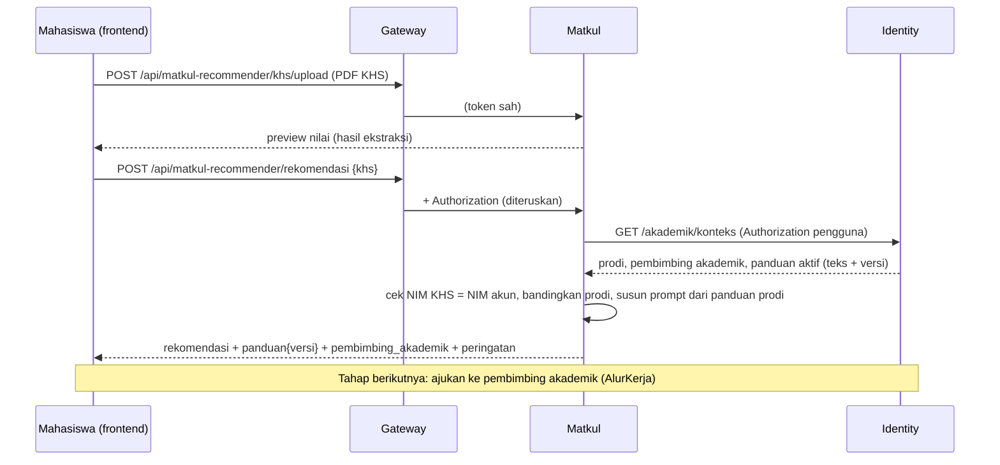

# 11. Integrasi Matkul dengan Identity

Tujuan: dasar rekomendasi mata kuliah adalah **panduan akademik prodi mahasiswa itu sendiri**, bukan berkas yang diunggah pengguna.

## Alur



Urutan di diagram sama dengan gagasan awal: mahasiswa prodi apa → KHS-nya → dicocokkan dengan panduan akademik prodinya → diajukan ke DPA.

## Pembagian tanggung jawab

| Hal | Pemilik |
|---|---|
| Prodi mahasiswa, DPA, versi panduan | identity (sumber tunggal) |
| Ekstraksi teks PDF panduan | identity, **saat unggah** (disimpan, tidak diekstrak ulang per permintaan) |
| Ekstraksi KHS dan penyusunan rekomendasi | matkul |
| Keputusan siapa boleh melihat apa | identity (matkul hanya meneruskan token) |

Matkul tidak memegang `JWT_SECRET` dan tidak membaca database identity. Ia meneruskan header `Authorization` pengguna ke identity, yang memvalidasi token (tanda tangan, kedaluwarsa, versi token, status akun) dan menghitung hak dari database.

## Kontrak: `GET /akademik/konteks`

Untuk mahasiswa: mengembalikan konteks dirinya. Untuk staf: wajib `?prodi_id=` dan dibatasi cakupan unit. `?tanpa_teks=true` melewatkan isi teks panduan (untuk tampilan).

```json
{
  "mahasiswa": { "id": "…", "nama_lengkap": "…", "nim": "20110001" },
  "prodi": {
    "id": "…", "kode": "IF-S1", "nama": "Informatika", "jenjang": "S1",
    "jurusan": { "id": "…", "kode": "IF", "nama": "Informatika" },
    "fakultas": { "id": "…", "kode": "FTI", "nama": "Fakultas Teknologi Industri" }
  },
  "pembimbing_akademik": { "id": "…", "nama_lengkap": "…", "email": "dosen@kampus.ac.id" },
  "panduan": { "id": "…", "versi": 2, "judul": "…", "berlaku_mulai": "2023-08-01", "teks_karakter": 76605, "teks": "…" }
}
```

| Status | Arti |
|---|---|
| 401 | token tidak sah |
| 403 | pemanggil bukan mahasiswa dan tidak menyertakan `prodi_id` |
| 404 | prodi belum punya panduan aktif (pesan menyebut nama prodi), atau prodi di luar cakupan staf |
| 409 | panduan aktif belum punya teks (unggah ulang) |

`pembimbing_akademik.email` adalah email akun dosen. Itu sama dengan identitas penerima tugas di Tasklist AlurKerja, sehingga tidak perlu pemetaan tambahan.

## Perubahan pada identity

- Kolom baru `panduan_akademik.teks` dan `teks_karakter` (migrasi 0002).
- Unggah panduan mengekstrak teks dengan `pypdf`. PDF rusak, terkunci, atau hampir tanpa teks (hasil scan) **ditolak 422** dengan pesan jelas. Dengan begitu tidak ada panduan aktif yang tidak bisa dipakai rekomendasi.
- Diuji pada panduan nyata (Informatika 2021/2022, 980 KB): 76.605 karakter dalam 1,5 detik.
- Teks tidak masuk audit log (terlalu besar).

## Perubahan pada matkul

| Berkas | Perubahan |
|---|---|
| `app/api/rekomendasi/route.ts` | bila ada `Authorization`: ambil konteks dari identity, **abaikan** `panduan_text` dari klien; cek NIM; peringatan prodi; respons memuat `panduan`, `pembimbing_akademik`, `peringatan` |
| `src/lib/identity.ts` | klien identity (10 detik timeout, galat dipetakan ke pesan dan status yang jelas) |
| `src/lib/konteks.ts` | logika murni: perbandingan NIM dan prodi |
| `app/api/panduan/extract-upload`, `app/khs/panduan/extract-upload` | ditandai DEPRECATED; hanya untuk uji lokal tanpa gateway |
| `docker-compose.yml` | `IDENTITY_URL=http://identity-api:8002`, matkul menunggu identity sehat |

### Aturan pemeriksaan

| Kasus | Perilaku |
|---|---|
| NIM pada KHS berbeda dari NIM akun | Tetap diproses; akun demo dapat memakai data KHS demonstrasi. |
| NIM tidak terbaca di KHS atau akun | lolos (ekstraksi AI bisa gagal membaca NIM) |
| Prodi pada KHS tidak mirip prodi akun | lolos dengan `peringatan`; rekomendasi tetap memakai panduan prodi akun |
| Prodi belum punya panduan aktif | **409** `panduan_belum_ada` |
| Pemanggil bukan mahasiswa | **403** `bukan_mahasiswa` |
| Identity tidak dapat dihubungi | **502** `identity_mati` |
| Tanpa header `Authorization` (pemanggilan langsung ke port debug) | jalur lama: memakai `panduan_text` dari body |

## Versi panduan dan pengajuan

Respons rekomendasi memuat `panduan.id` dan `panduan.versi`. Pengajuan ke pembimbing akademik **harus menyimpan nilai ini** supaya keputusan tetap merujuk aturan yang berlaku saat diajukan, walau kaprodi kemudian mengaktifkan versi baru (skenario S4 di [08](08-skenario-dan-kasus-tepi.md)).

## Pengajuan ke pembimbing akademik

Sudah dibuat: [12](12-pengajuan-ke-dpa.md) (API) dan [13](13-proses-alurkerja-penuh.md) (proses AlurKerja lengkap). Rute `/api/rekomendasi` di atas tetap ada sebagai **pratinjau** instan di wizard; hasil resmi untuk pembimbing disusun proses di server dari berkas KHS yang sama (hasil bacaannya dipakai ulang, lihat 13).

## Frontend (sudah dipindah ke identity)

| Hal | Perubahan |
|---|---|
| Login | `POST /api/identity/auth/login`; akun dibuat admin (tidak ada pendaftaran mandiri, tombol daftar dihapus) |
| Sandi sementara | akun baru wajib mengganti sandi di layar login sebelum bisa memakai layanan (minimal 10 karakter) |
| Profil | dibaca dari `GET /auth/saya` (nama, NIM, prodi, fakultas); tampilan profil menjadi baca-saja karena data dikelola admin |
| Ganti sandi | `POST /auth/ganti-sandi`; token lama otomatis tidak sah, token baru langsung disimpan |
| Token | access token 15 menit diperbarui diam-diam memakai refresh token. Satu proses per tab dan satu lintas tab (Web Locks) supaya refresh token sekali-pakai tidak terpakai dua kali (yang akan mencabut seluruh sesi) |
| Keluar | mencabut refresh token di server |
| Langkah 4 rekomendasi | bukan lagi unggah panduan, melainkan kartu "Panduan akademik prodi Anda" (judul, versi, tanggal berlaku, DPA, tombol lihat PDF). Prodi tanpa panduan aktif menampilkan pesan dan tombol coba lagi; tombol Lanjut dinonaktifkan |
| Hasil rekomendasi | menampilkan dasar rekomendasi ("Panduan akademik Prodi X, versi N") dan peringatan bila prodi KHS berbeda |

Diuji di browser terhadap tumpukan nyata (frontend, NGINX, verifier, identity, matkul, OpenAI tiruan): login, ganti sandi wajib, profil, unggah KHS, langkah panduan, hasil rekomendasi, dan pemulihan sesi dari access token rusak.

### Dampak yang perlu diketahui

- **Micro-Credential (asesmen) tidak berfungsi untuk akun identity.** Layanan itu masih memakai tabel pengguna miliknya sendiri, jadi menolak token identity. Frontend menampilkan pesan "belum tersedia" dan **tidak** mengeluarkan pengguna dari sesi. Memindahkan Micro-cred ke akun identity adalah pekerjaan tersendiri.
- Akun lama (Micro-cred) tidak bisa login di frontend baru. Akun harus dibuat ulang di identity.

### Catatan lingkungan Windows

Di sebagian mesin Windows, Hyper-V mencadangkan rentang port (mis. 7970–8069 dan 8100–8109), sehingga port debug 8002 atau 8100 gagal terikat (WinError 10013). Cek dengan `netsh interface ipv4 show excludedportrange protocol=tcp`; ubah pemetaan port di `docker-compose.override.yml` bila perlu. Port ini hanya untuk debug; lalu lintas normal lewat gateway.
