# 12. Pengajuan ke Dosen Pembimbing Akademik

Menutup alur: **prodi → KHS → dicocokkan dengan panduan prodi → diajukan ke DPA**. Proses lengkapnya (langkah AI di dalam AlurKerja, worker, BPMN) ada di [13](13-proses-alurkerja-penuh.md); dokumen ini membahas sisi identity: API, status, mode, dan konsistensi.

> Rancangan awal memakai "paket rekomendasi bertanda tangan" (AlurKerja hanya untuk persetujuan). Itu **sudah diganti**: rekomendasi sekarang dihitung proses di server dari KHS asli yang diunggah, jadi tidak ada lagi paket, `HASIL_SECRET`, atau tanda tangan.

## Keputusan: tempat status pengajuan (Q21)

Status disimpan di **identity** (tabel `pengajuan`). Data mahasiswa, DPA, prodi, dan versi panduan sudah di sana; `program` (StudentGateway) punya akun dan basis data sendiri yang berbeda. Hasil langkah AI (KHS terbaca, rencana) disimpan layanan **matkul**; identity hanya menyalin ringkasan tanpa nama untuk ditampilkan. Batasnya jelas: `routes/pengajuan.py` dan `integrations/`.

## Alur

```mermaid
sequenceDiagram
    participant M as Mahasiswa
    participant I as Identity
    participant K as Matkul
    participant A as AlurKerja
    participant W as Worker
    participant D as DPA (Tasklist)
    M->>I: POST /pengajuan (PDF KHS + semester)
    I->>K: upload berkas KHS (token layanan)
    I->>A: mulai proses + selesaikan "Unggah KHS"
    A->>W: tugas baca KHS
    W->>K: extract-khs (id_pengajuan)
    K->>I: konteks (prodi, NIM, panduan aktif)
    W->>A: hasil (keyakinan, IPK, ...)
    alt keyakinan < 0,9
        A-->>M: tahap "periksa"
        M->>I: POST /pengajuan/{id}/periksa
        I->>A: selesaikan "Periksa"
    end
    A->>W: tugas rekomendasi
    W->>K: recommend
    A-->>D: tugas tinjau (Tasklist)
    D->>A: setuju atau revisi + catatan
    opt revisi
        A->>W: tugas revisi
        W->>K: revise (catatan dosen)
    end
    M->>I: GET /pengajuan/{id} (polling)
    I->>A: baca aktivitas, variabel, insiden
    I-->>M: tahap, langkah, hasil, status
```

## Mode

| | Mode AlurKerja | Mode lokal |
|---|---|---|
| Aktif bila | `ALURKERJA_URL`, `ALURKERJA_USERNAME`, `ALURKERJA_PASSWORD` terisi | ketiganya kosong |
| Langkah AI | worker `alurkerja-connector` | identity memanggil matkul sendiri, di latar belakang, dengan urutan yang sama |
| Keputusan DPA | Tasklist AlurKerja | `POST /pengajuan/{id}/keputusan` |
| Keadaan | dibaca dari Camunda saat pengajuan dibuka atau didaftar | langsung dari database |
| Kegunaan | produksi | pengembangan dan uji tanpa AlurKerja |

Mode tercatat per pengajuan.

## API

| Method | Path | Akses |
|---|---|---|
| POST | `/pengajuan` | mahasiswa; `multipart`: `berkas` (PDF KHS, maks. 15 MB), `semester_target` (1–14) |
| GET | `/pengajuan?status=&mahasiswa_id=&dpa_id=&prodi_id=` | mahasiswa (miliknya), DPA (bimbingannya), kaprodi/kajur/dekan (cakupan prodi), superadmin |
| GET | `/pengajuan/{id}` | sama; memuat `langkah`, `hasil_bacaan`, `rencana` |
| POST | `/pengajuan/{id}/periksa` | pengaju; hanya saat `tahap = periksa` |
| POST | `/pengajuan/{id}/batalkan` | pengaju (atau superadmin); menghentikan proses di AlurKerja |
| POST | `/pengajuan/{id}/keputusan` | DPA yang ditugaskan; **hanya mode lokal**; `setuju` atau `revisi` (catatan wajib) |

**Status** (akhir): `diajukan` (masih berjalan), `disetujui`, `dibatalkan`. **Tahap** (posisi proses): `ekstraksi`, `periksa` (menunggu mahasiswa), `rekomendasi`, `tinjau` (menunggu DPA), `revisi`, `selesai`. Satu mahasiswa hanya boleh punya satu pengajuan `diajukan` (indeks unik parsial). Revisi bukan status akhir: siklus revisi → tinjau berulang di dalam proses yang sama. Opsi "tolak" tidak ada karena BPMN aslinya memang hanya `setuju` atau `revisi`.

## Pemeriksaan saat mengajukan

| Kasus | Respons |
|---|---|
| bukan mahasiswa | 403 |
| bukan PDF | 400; lebih dari 15 MB: 413; semester di luar 1–14: 422 |
| prodi belum punya panduan aktif | 409 |
| belum punya DPA, atau DPA belum punya akun | 409 |
| sudah ada pengajuan berjalan | 409 |
| KHS milik orang lain (NIM di KHS ≠ NIM akun) | proses berhenti di tahap `periksa` (keyakinan dipaksa 0); `/periksa` ditolak 409; hanya bisa dibatalkan |
| layanan matkul atau AlurKerja tidak terjangkau | 502, **tidak ada data yang tersimpan** |

## Perilaku yang menjaga konsistensi

| Kejadian | Perilaku |
|---|---|
| Proses AlurKerja dimulai tetapi langkah berikutnya gagal | proses dihentikan (tidak ada proses yatim), 502 |
| Simpan ke database gagal setelah proses dimulai | proses dihentikan |
| Langkah AI gagal di worker (insiden Camunda) | `pesan_galat` tampil; mahasiswa bisa membatalkan dan mengajukan ulang |
| Sinkron status gagal (jaringan) | status tidak berubah, pembacaan tetap 200 |
| Proses dihentikan dari AlurKerja | menjadi `dibatalkan` |
| DPA berganti (buat atau pindahkan bimbingan) | variabel `dosen_pa` **dan** tugas tinjauan yang terbuka dipindah; bila AlurKerja gagal, seluruh pemindahan dibatalkan (502) |
| Mahasiswa lulus, keluar, atau pindah prodi | proses dihentikan, pengajuan `dibatalkan` |
| Panduan prodi diperbarui di tengah proses | versi yang dipakai adalah versi saat ekstraksi, disimpan matkul bersama KHS dan dicatat di pengajuan; `versi_aktif_sekarang` menunjukkan bila sudah ada yang lebih baru |

Nama mahasiswa **tidak dikirim** ke AlurKerja (hanya NIM). Rencana yang disalin ke identity berasal dari variabel proses dan memang bebas nama dan NIM.

## Yang diuji

- **Otomatis (identity, 30 tes pengajuan):** seluruh alur di kedua mode, siklus revisi, langkah periksa, KHS orang lain, insiden, dihentikan dari luar, kegagalan di tiap langkah, pemindahan DPA, hak akses, audit. Camunda dan matkul ditiru.
- **Menyeluruh dengan komponen sungguhan:** worker `alurkerja-connector` sungguhan, matkul sungguhan (Next.js + Postgres sendiri, OpenAI ditiru), identity, verifier, NGINX, dan frontend di browser; yang ditiru hanya Camunda (server HTTP tiruan yang menjalankan urutan BPMN) dan LLM. Hasil: dari unggah KHS sampai disetujui, termasuk periksa dan satu siklus revisi.
- **Belum:** AlurKerja/Camunda sungguhan. Lihat [13](13-proses-alurkerja-penuh.md), bagian "Yang belum terbukti".

Antarmuka DPA di superapp tidak ada: pada mode AlurKerja DPA bekerja di Tasklist, pada mode lokal lewat API.
