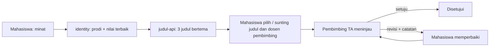

# 14. Pengajuan judul tugas akhir (sampai pembimbing TA)

Dibangun 26 Nov 2026. Tampilan web dikerjakan terpisah, panduannya di [`docs/judul-ui/`](../judul-ui/README.md).

## Keputusan

| Hal | Pilihan |
|---|---|
| Peninjau | **Dosen pembimbing TA** aktif yang dipilih mahasiswa dari daftar dosen prodinya; penugasan kaprodi dapat menjadi pilihan awal |
| Revisi | **Mahasiswa** memperbaiki sendiri di web, lalu ditinjau lagi |
| Tema | Setiap rekomendasi dan pengajuan punya **satu tema dari daftar baku**, untuk rekap per prodi |
| Penyedia AI | Groq (`GROQ_API_KEY` di `services/judul/.env`) |

## Alur



- BPMN: [`alurkerja/pengajuan-judul-superapp.bpmn`](../../alurkerja/pengajuan-judul-superapp.bpmn). Tidak ada External Task, jadi worker connector tidak dipakai.
- Tugas `Task_TinjauJudul`: penerima = email pembimbing (`pembimbing`). Keluaran `keputusan` (`setuju`/`revisi`) dan `catatan_dosen`.
- Tugas `Task_PerbaikiJudul`: penerima `initiator` (akun layanan); identity menyelesaikannya saat mahasiswa mengirim perbaikan.
- Variabel proses: `pembimbing`, `initiator`, `nim_mahasiswa`, `id_pengajuan`, `prodi`, `topik`, `judul`, `tema`, `ringkasan_judul` (HTML ≤ 3900 karakter), `jumlah_revisi`. Nama mahasiswa tidak dikirim.
- Mode `lokal` (AlurKerja tidak dikonfigurasi): alur yang sama tanpa AlurKerja.

## Brainstorm sebelum memilih (migrasi 0006)

Halaman `/judul/rekomendasi` memisahkan tiga hal: **ngobrol, membahas kandidat, dan memilih**.

1. **Brainstorm**: AI bertanya balik dan menawarkan arah, tanpa memberi judul.
2. **Kandidat**: tombol "Buatkan judul" menambah tiga kandidat dari arah yang dibicarakan. Tiap kandidat bisa **Dibahas** (utas sendiri), **Disimpan**, atau diperbaiki menjadi **versi baru** dari usulan AI.
3. **Pilih**: hanya terjadi saat **Ajukan**, lewat formulir dan `POST /pengajuan-judul` seperti sebelumnya.

| Rute identity (hanya pemilik) | Guna |
|---|---|
| `GET /judul/obrolan` | daftar obrolan |
| `POST /judul/obrolan` | mulai (`pesan`) atau buka riwayat lama (`dari_rekomendasi`, tanpa AI) |
| `GET /judul/obrolan/{id}` | isi obrolan |
| `POST /judul/obrolan/{id}/pesan` | satu giliran; `kandidat_id` untuk membahas satu kandidat |
| `POST /judul/obrolan/{id}/kandidat` | buat tiga kandidat |
| `PATCH /judul/obrolan/{id}/kandidat/{kid}` | simpan atau lepas simpanan |
| `POST /judul/obrolan/{id}/versi` | simpan usulan perbaikan sebagai kandidat baru |

Tabel `obrolan_judul` (pesan dan kandidat berupa JSON). Layanan judul: `POST /chat` (`services/judul/services/obrolan_service.py`), dan `/get-recommendations` menerima `diskusi`. Batas: 40 pesan per obrolan, 10 obrolan baru per 24 jam, 15 kandidat (yang disimpan atau pernah dibahas tidak dibuang), 16 pesan terakhir sebagai konteks AI. Isi obrolan tidak dikirim ke AlurKerja dan tidak terlihat dosen.

## Data (migrasi 0005)

| Tabel | Isi |
|---|---|
| `pembimbing_ta` | penunjukan pembimbing; satu aktif per mahasiswa, riwayat tersimpan |
| `pengajuan_judul` | judul, tema, deskripsi, metodologi, kata kunci, referensi, status, tahap, catatan, jumlah revisi, instans AlurKerja; satu terbuka per mahasiswa |
| `rekomendasi_judul` | riwayat rekomendasi per mahasiswa |

Status: `diajukan`, `disetujui`, `dibatalkan`. Tahap: `tinjau`, `perbaikan`, `selesai`.

## Kode

| Bagian | Berkas |
|---|---|
| Rute | `services/identity/src/api/routes/judul.py`, `obrolan_judul.py` |
| Daftar tema | `services/identity/src/domain/tema.py` (salinan cadangan: `services/judul/services/prompt_service.py`) |
| Klien layanan judul | `services/identity/src/integrations/judul.py` |
| Prompt dan perapian keluaran AI | `services/judul/services/prompt_service.py`, `ai_service.py` |
| Tes | `services/identity/tests/test_judul.py`, `test_obrolan_judul.py` |

Konfigurasi identity (bawaan sudah benar): `JUDUL_URL=http://judul-api:8001`, `ALURKERJA_PROCESS_KEY_JUDUL=pengajuan-judul-superapp`; AlurKerja memakai `ALURKERJA_*` yang sama dengan proses mata kuliah, termasuk `ALURKERJA_TENANT_ID` lingkungan Live.

## Menyiapkan AlurKerja

1. Studio > Drive: unggah BPMN. Studio mewajibkan kejadian awal dan tugas pertama berada di jalur teratas.
2. Form tugas **Perbaiki judul**: field Rich Text berkunci `ringkasan_judul` (hanya agar variabelnya bisa dipilih di komponen berikut).
3. Form tugas **Tinjau**: komponen *Rich Text From Variable* (sumber `ringkasan_judul`), `keputusan` (radio, wajib), `catatan_dosen` (wajib bila `keputusan == 'revisi'`).
4. Deploy ke **Live** (hanya Owner). Dosen pembimbing harus anggota workspace dengan email yang sama dengan akunnya di aplikasi.

## Terbukti di AlurKerja lokal (26 Nov 2026)

Deploy Live versi 1. Instans 4677: diajukan, pembimbing meminta revisi, mahasiswa memperbaiki, disetujui (`COMPLETED`). Tugas ditujukan ke email pembimbing, nama mahasiswa tidak ikut terkirim, dan rekap tema menghitungnya. Uji memanggil fungsi rute identity di dalam container (belum lewat HTTP, web, atau Tasklist). Layanan judul mengulang sampai 3 kali bila model menghasilkan JSON tidak sah atau sambungan putus.

## Analytics

`GET /judul/statistik-tema` memberi rekap tema per prodi dari basis data identity (dibatasi cakupan pengguna). Dashboard AlurKerja **Dashboard Kaprodi - Judul Tugas Akhir** membaca `<<pengajuan-judul-superapp>>` (variabel `tema`, `prodi`, `jumlah_revisi`) dan tampil sebagai tab di `/dosen/analitik`. Contoh pertanyaannya:

```sql
SELECT COALESCE(prodi, 'tidak diketahui') AS "Prodi", tema AS "Tema", COUNT(*) AS "Jumlah judul"
FROM <<pengajuan-judul-superapp>>
WHERE state NOT IN ('EXTERNALLY_TERMINATED', 'INTERNALLY_TERMINATED')
GROUP BY prodi, tema ORDER BY "Jumlah judul" DESC
```

## Batasan

- Tema pilihan AI bisa meleset; mahasiswa dapat menggantinya sebelum mengajukan.
- Ketiga rekomendasi bisa bertema sama bila minatnya sempit.
- Referensi dari Semantic Scholar tanpa API key sering terkena pembatasan, lalu diganti tautan pencarian Google Scholar.
- Daftar tema disusun untuk rumpun informatika; prodi lain akan banyak jatuh ke "Lainnya" sampai daftarnya disesuaikan.
- Rute lama `/api/judul-recommender/*` masih ada (tanpa konteks dan riwayat); hapus setelah web memakai rute identity.
