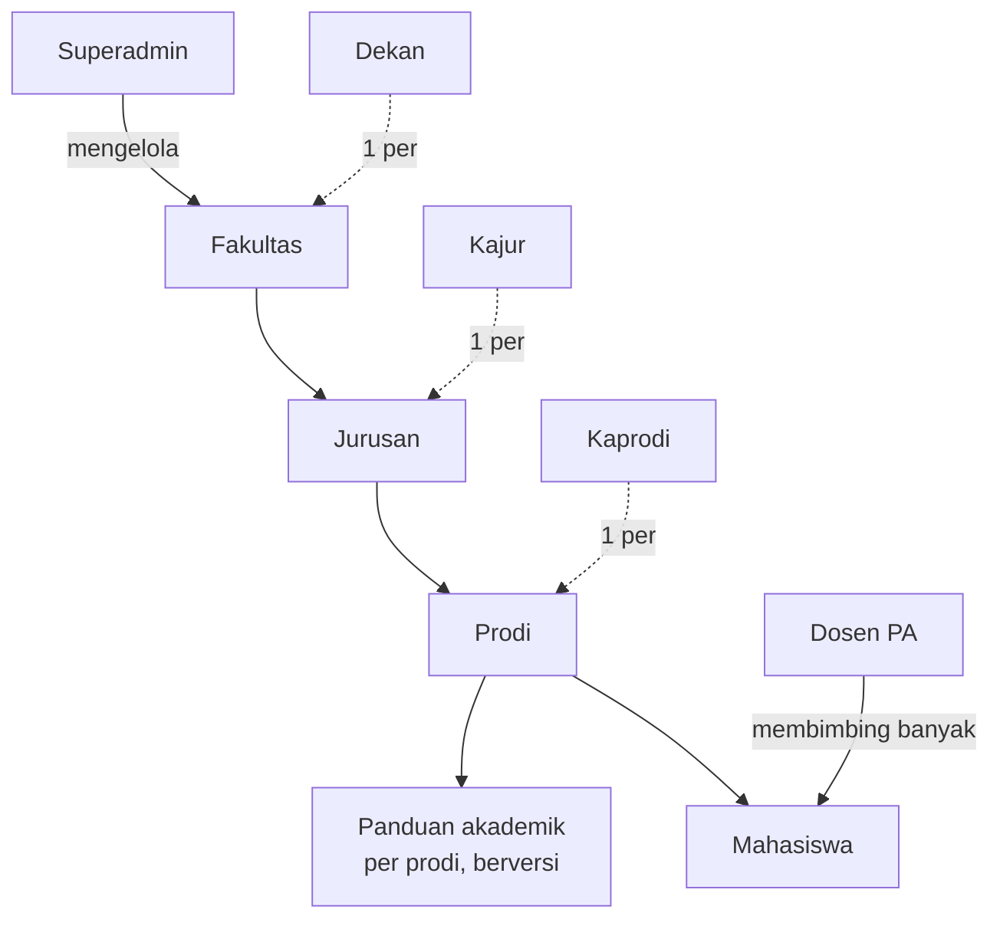

# Layanan Identity: Dokumen Rancangan

Status: **tahap 0 sampai 12 sudah diimplementasi** di `services/identity` (83 tes lulus terhadap Postgres sungguhan; alur lewat gateway diuji manual). Dokumen ini adalah rancangan asalnya; bagian yang berubah saat implementasi ditandai di [09](09-rencana-implementasi.md). Cara menjalankan: [services/identity/README.md](../../services/identity/README.md).

Tujuan: satu sumber kebenaran untuk struktur organisasi kampus (fakultas, jurusan, prodi), akun, peran, dan relasi dosen pembimbing akademik (PA) dengan mahasiswa. Superadmin mengelola semuanya.

## Daftar dokumen

| No | Dokumen | Isi |
|---|---|---|
| 01 | [Keputusan dan asumsi](01-keputusan-dan-asumsi.md) | Apa yang sudah diputuskan dan apa yang diasumsikan |
| 02 | [Struktur organisasi](02-struktur-organisasi.md) | Hierarki, aturan jumlah, contoh data |
| 03 | [Peran dan hak akses](03-peran-dan-hak-akses.md) | Matriks siapa boleh apa, dan ruang lingkup unit |
| 04 | [Model data](04-model-data.md) | ERD, tabel, kolom, batasan database |
| 05 | [Alur auth dan token](05-alur-auth-dan-token.md) | Login, klaim JWT, masa berlaku, pencabutan |
| 06 | [Draf API](06-api-draf.md) | Endpoint, kontrak, kode galat |
| 07 | [Integrasi dan penonaktifan yang lama](07-integrasi-dan-deprecation.md) | NGINX, verifier, layanan lain, daftar yang diberi komentar deprecated |
| 08 | [Skenario dan kasus tepi](08-skenario-dan-kasus-tepi.md) | Alur nyata dan hal yang sering salah |
| 09 | [Rencana implementasi](09-rencana-implementasi.md) | Tahap kerja, uji, kriteria selesai |
| 10 | [Pertanyaan terbuka](10-pertanyaan-terbuka.md) | Yang belum diputuskan |
| 11 | [Integrasi matkul](11-integrasi-matkul.md) | Panduan per prodi sebagai dasar rekomendasi, kontrak, pemeriksaan |
| 12 | [Pengajuan ke DPA](12-pengajuan-ke-dpa.md) | API, status dan tahap, mode, konsistensi |
| 13 | [Proses AlurKerja lengkap](13-proses-alurkerja-penuh.md) | BPMN, connector, langkah AI di matkul, panduan per prodi di dalam proses, menjalankan |

## Halaman administrasi

Alamat `/admin/beranda` (`/admin` mengalihkan ke sana; tautan "Administrasi" muncul di sidebar beranda bagi superadmin, dekan, kajur, dan kaprodi). Tab:

| Tab | Isi | Siapa |
|---|---|---|
| Struktur | fakultas, jurusan, prodi, batas SKS per prodi, aktif/nonaktif | superadmin mengubah; lainnya hanya melihat |
| Orang & akun | cari orang, buat orang dan akun, atur ulang sandi, ubah status akun, keanggotaan prodi (daftar, cuti, lulus, keluar, pindah), impor CSV | superadmin (kaprodi mendaftarkan mahasiswa di prodinya) |
| Penugasan | dekan, kajur, kaprodi, dosen PA, superadmin | superadmin; kaprodi hanya dosen PA di prodinya |
| DPA | bimbingan mahasiswa ke dosen PA, alihkan massal | superadmin, kaprodi |
| Panduan | unggah PDF sebagai draf, aktifkan, buka PDF, riwayat versi | superadmin, kaprodi prodinya |
| Audit | jejak perubahan, filter aksi, rincian sebelum/sesudah | superadmin |

Sandi sementara (akun baru, atur ulang sandi, impor CSV) hanya tampil sekali. Hak akses tetap ditegakkan server; tampilan hanya menyembunyikan tombol. Kode: `frontend/app/admin`, `frontend/components/admin`, `frontend/src/services/admin-service.ts`.

## Ringkasan satu halaman

## Keputusan inti

1. Hierarki: **Fakultas → Jurusan → Prodi**.
2. Panduan akademik melekat pada **prodi** dan bisa diperbarui (berversi).
3. Akun dibuat **baru** di layanan `identity` dengan database Postgres sendiri.
4. Akun lama (Micro-cred dan PocketBase) **tidak dihapus**, hanya diberi komentar bahwa tidak dipakai lagi.
5. Struktur organisasi disimpan di **Postgres**.
